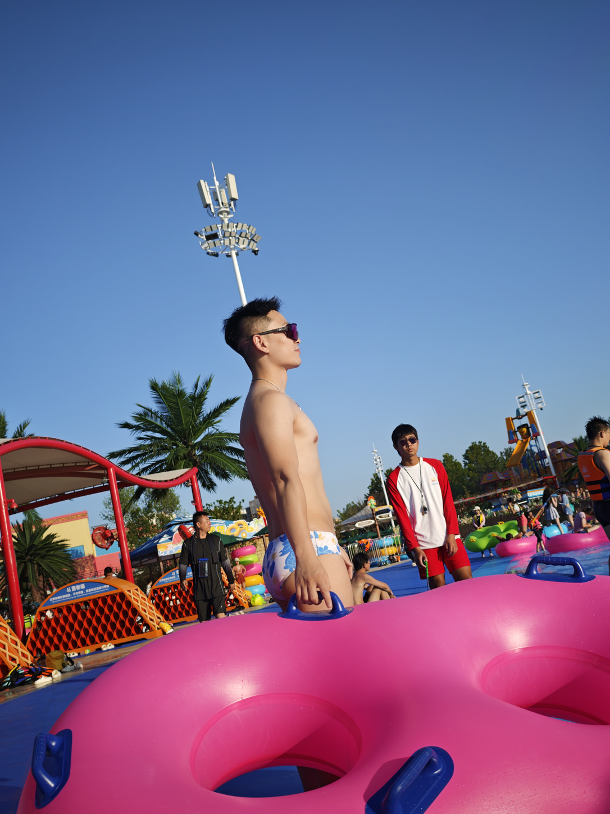
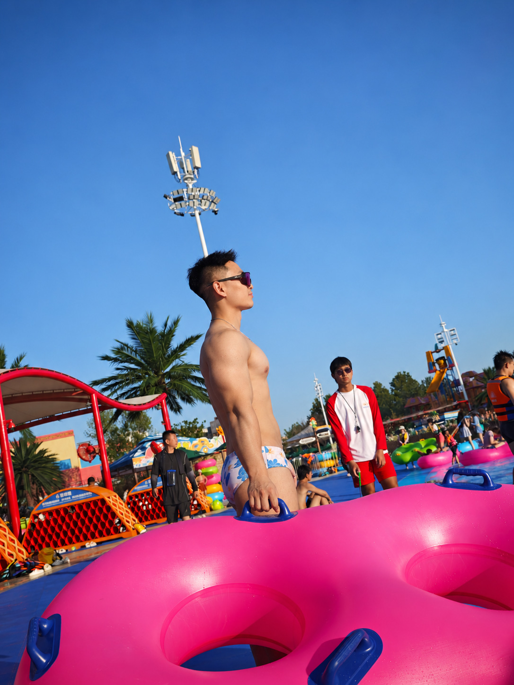

# 案例

[薄肌感男生修图 Skill · 项目首页](../README.md)

| 案例1 原图 | 案例1 修图后 | 案例2 原图 | 案例2 修图后 |
| --- | --- | --- | --- |
|  |  |  |  |

| 案例3 原图 | 案例3 修图后 | 案例4 原图 | 案例4 修图后 |
| --- | --- | --- | --- |
|  |  |  |  |

| 案例5 原图 | 案例5 修图后 | 案例6 原图 | 案例6 修图后 |
| --- | --- | --- | --- |
|  |  |  |  |

| 案例7 原图 | 案例7 修图后 | 案例8 原图 | 案例8 修图后 |
| --- | --- | --- | --- |
|  |  |  |  |

| 案例9 原图 | 案例9 修图后 | 案例10 原图 | 案例10 修图后 |
| --- | --- | --- | --- |
|  |  |  |  |

| 案例11 原图 | 案例11 修图后 | 案例12 原图 | 案例12 修图后 |
| --- | --- | --- | --- |
|  |  |  |  |

| 案例13 原图 | 案例13 修图后 | 案例14 原图 | 案例14 修图后 |
| --- | --- | --- | --- |
|  |  |  |  |

| 案例15 原图 | 案例15 修图后 | 案例16 原图 | 案例16 修图后 |
| --- | --- | --- | --- |
|  |  |  |  |

图片来源

- 图片按用户指定的原图与成片配对，保留完整画幅等比展示。
- 案例15、16分别为温泉侧身坐姿与泳池侧身站姿，按用户本次指定的原图与已认可修后图配对发布。
- 案例15、16使用网盘备份的 1.4.0 本地修订版（2026-10-20 肩部、腿部与真实感修订）完成，属于生成式修图案例，不作为当前 1.5.0 规则的出图验证或真实训练前后记录。
- 本页只展示现有图片，不额外修图；展示副本经过格式转换、等比缩小及网页压缩，已去除 EXIF。
- 图片来源不因进入仓库而改变，公开可见不等同于授予图片任意使用许可。

[返回首页](../README.md)
