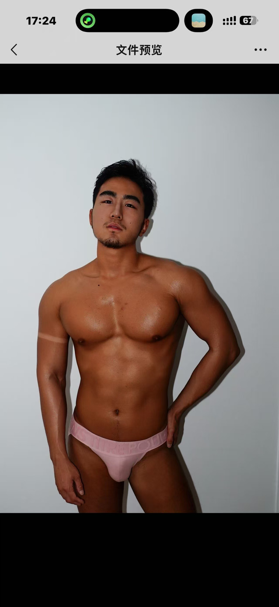

# 修图前后案例参考

共15组按用户指定的原图与成片配对，另收录一张待补成片的原图。左侧为修图前，右侧为修图后；仅做格式转换、等比缩小和网页压缩，不额外修饰图片内容。

## 案例1

关注面部状态、胸肩撑衣感与上臂量感。

| 修图前 | 修图后 |
| --- | --- |
|  |  |

## 案例2

关注胸肩体积、自然线条与海边摄影氛围。

| 修图前 | 修图后 |
| --- | --- |
|  |  |

前后画幅不同，按各自完整画幅展示，未强行裁切或拉伸。

## 案例3

关注近景面部状态、胸肩臂的衣料撑起与健身房原有光线。

| 修图前 | 修图后 |
| --- | --- |
|  |  |

## 案例4

关注半侧面肩部厚度、胸臂轮廓与真实衣料呈现。

| 修图前 | 修图后 |
| --- | --- |
|  |  |

## 本次补充 · 2026-10-20

以下保留本组原编号，方便与本地文件对应。本组03未收录；本组01、06、07、10、11使用返修版 v2，其余使用当前首轮成片。

## 案例5 · 海边赤膊（本组编号 01）

展示版本：返修版 v2。

| 01原图 | 01修图后 |
| --- | --- |
|  |  |

## 案例6 · 浅蓝短袖镜前（本组编号 04）

展示版本：首轮成片。

| 04原图 | 04修图后 |
| --- | --- |
|  |  |

## 案例7 · 坐姿桨板赤膊（本组编号 05）

展示版本：首轮成片。

| 05原图 | 05修图后 |
| --- | --- |
|  |  |

## 案例8 · 灰色背心侧身（本组编号 06）

展示版本：返修版 v2。

| 06原图 | 06修图后 |
| --- | --- |
|  |  |

## 案例9 · 黑色短袖（本组编号 07）

展示版本：返修版 v2。

| 07原图 | 07修图后 |
| --- | --- |
|  |  |

## 案例10 · 橙墙镜前（本组编号 08）

展示版本：首轮成片。

| 08原图 | 08修图后 |
| --- | --- |
|  |  |

## 案例11 · 紫色长袖拿玩偶（本组编号 09）

展示版本：首轮成片。

| 09原图 | 09修图后 |
| --- | --- |
|  |  |

## 案例12 · 跪姿桨板赤膊（本组编号 10）

展示版本：返修版 v2。

| 10原图 | 10修图后 |
| --- | --- |
|  |  |

## 案例13 · 黑色背心（本组编号 11）

展示版本：返修版 v2。

| 11原图 | 11修图后 |
| --- | --- |
|  |  |

## 案例14 · 紫色长袖正面（本组编号 12）

展示版本：首轮成片。

| 12原图 | 12修图后 |
| --- | --- |
|  |  |

## 案例15 · 紫色长袖侧身举臂（本组编号 13）

展示版本：首轮成片。

| 13原图 | 13修图后 |
| --- | --- |
|  |  |

## 待补成片：本组编号 02

目前仅有原图，未生成修图后；单独保留素材记录，不计入前后对照数量。

## 图片来源与说明

- 案例1、案例3和案例4的原图由用户提供，为 HEIC 照片的网页转换副本。
- 案例2原图为用户提供的小红书图片，文件标注作者“小马快跑”；原始帖子链接未随图片提供。
- 全部成片均由用户指定展示。本次入库只整理现有原图与最新成片，没有重新生成；本页不将案例作为当前 Skill 版本、具体模型、首轮成功率或跨工具复现效果的证明。
- 新增案例5–15与待补02均为用户本次指定收录的本地图片；只导出保留完整画幅的网页副本。返修版不作为首轮出图效果展示。
- 展示副本已去除 EXIF，不上传原始附件或本地来源记录。图片来源不因进入仓库而改变，仓库公开可见不等同于授予图片任意使用许可。

[返回首页](../README.md) · [查看修图规则](../skills/athletic-male-photo-retouch/SKILL.md)

