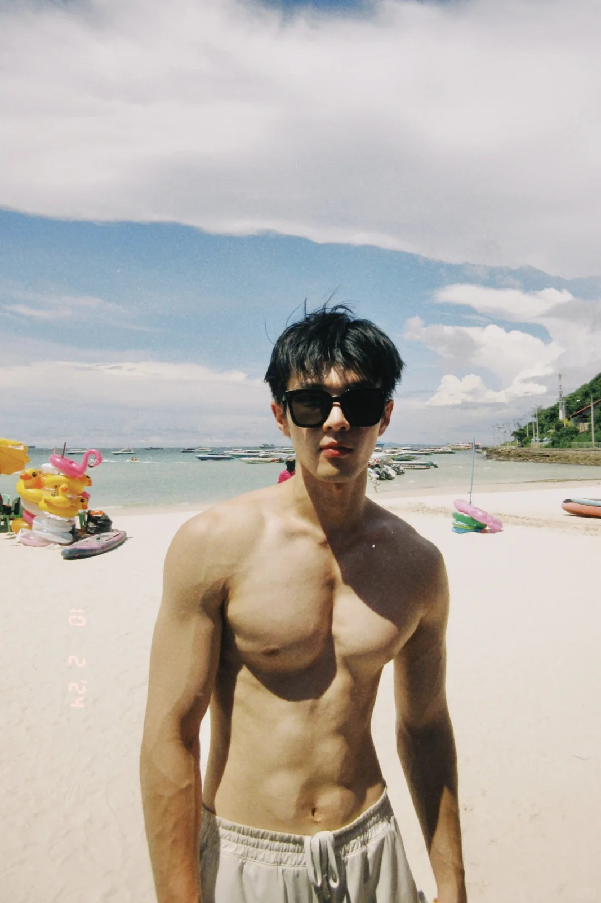
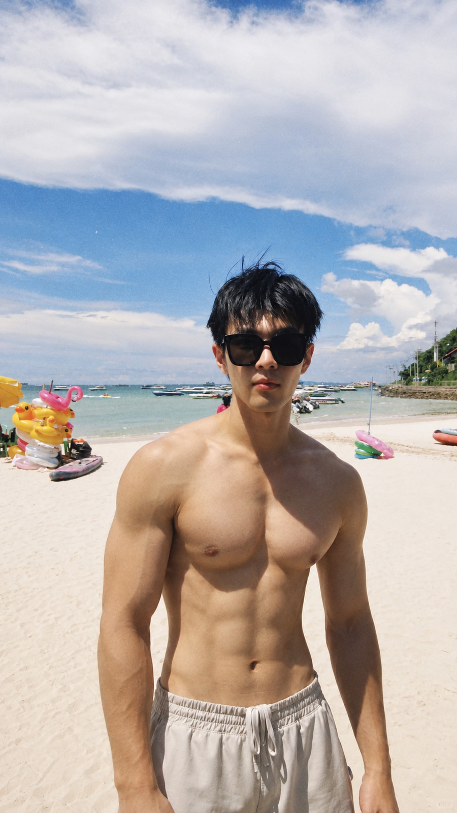

# 修图前后案例参考

以下两组原图与成片由用户提供，用于展示目标审美。左侧为修图前，右侧为修图后；仅做格式转换、等比缩小和网页压缩，不额外修饰图片内容。

## 01 · 灰墙白色紧身衣

关注面部纹路与精神状态、胸肩撑衣感、上臂量感，以及灰墙环境下的自然皮肤与衣料质感。

| 修图前 | 修图后 |
| --- | --- |
|  |  |

## 02 · 海边赤膊

关注胸肩饱满度、手臂和腰腹的自然线条，同时观察海边阳光、皮肤质感与环境氛围。

| 修图前 | 修图后 |
| --- | --- |
|  |  |

这组前后图片画幅不同，按各自完整画幅展示，未为对齐而裁切或拉伸。

## 图片来源与使用说明

- 两组均按用户本次指定的原图与成片配对；本次仅整理展示，没有重新生成。
- 灰墙原图由用户提供，为 HEIC 照片的网页转换副本。
- 海边原图为用户提供的小红书图片，文件标注作者“小马快跑”；原始帖子链接未随图片提供。
- 成片由用户提供。模型型号、完整提示词与生成轮次未随这两组图片提供，案例不作为当前版本首轮效果或跨工具复现率的证明。
- 展示副本已去除 EXIF；原始附件及本地路径未上传。图片来源不因进入仓库而改变，仓库公开可见不等同于授予案例图片的任意使用许可。

[返回首页](../README.md) · [查看修图规则](../skills/athletic-male-photo-retouch/SKILL.md)

